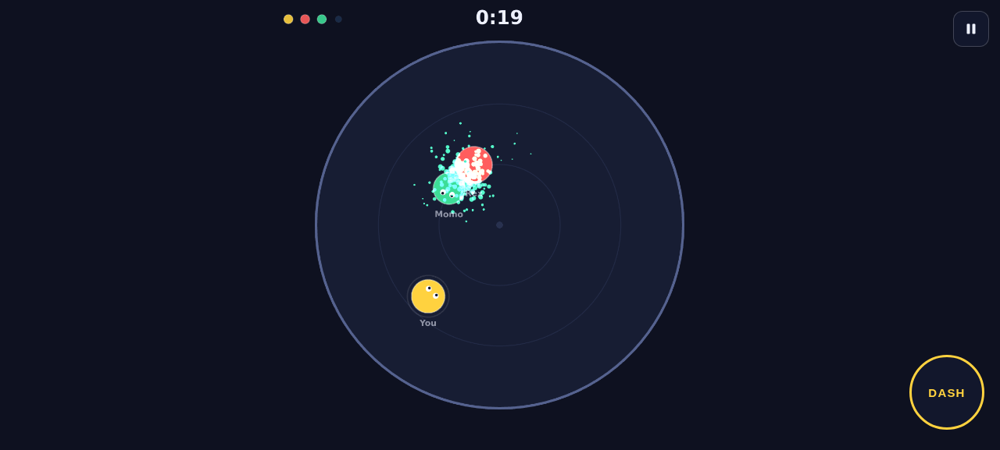
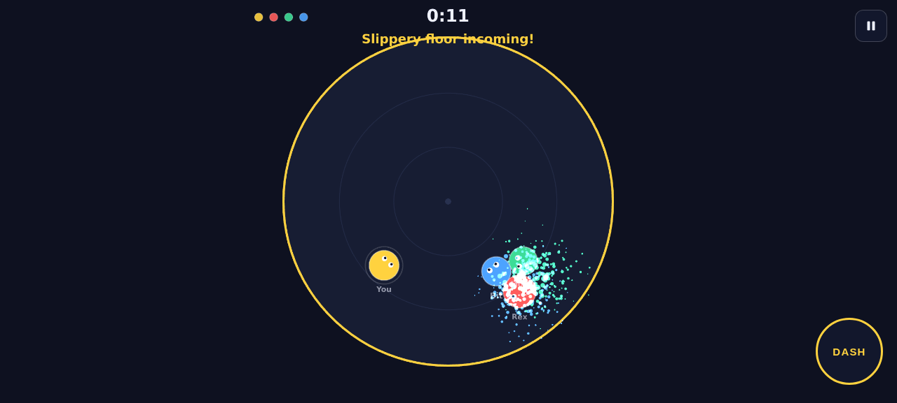

# Last One Laughing

A mobile-first 2D browser game prototype: a knockout arena where you bump,
dash and shove three bots off a shrinking circle floor. **Last one standing
wins.** Built with **Phaser 3 + TypeScript + Vite**, no art assets —
everything is geometric shapes and synthesized sound.



## Status: online multiplayer (stage 2) implemented

- **Solo mode** (3 bots with distinct personalities) is complete and
  unchanged.
- **Online multiplayer is live**: 2-8 players, private rooms with 6-char
  codes + shareable links, ready-up lobby, server-authoritative matches
  (Colyseus 0.18 + `@colyseus/schema` 5), reconnection support, and an
  automated test suite including a two-client proof. See
  [docs/stage-2-plan.md](docs/stage-2-plan.md) and
  [docs/colyseus-api-verification.md](docs/colyseus-api-verification.md).
- No accounts, database, payments, or analytics.

## Quick start

Prerequisites: **Node.js >= 22** (Colyseus 0.18 requires it) and npm. The
repo is an npm workspace with three packages: `client/` (Phaser game),
`shared/` (engine-agnostic simulation + net schema) and `server/`
(Colyseus authoritative server).

```bash
# 1. Clone
git clone https://github.com/<owner>/last-one-laughing.git
cd last-one-laughing

# 2. Install all workspaces
npm install

# 3. Run client + server together (dev)
npm run dev
#   - web client: http://localhost:5173 (Play online -> create/join)
#   - game server: http://localhost:8787 (also serves the built client)

# 4. Production client build (typecheck + bundle)
npm run build

# 5. Simulation tests (RoundEngine unit + two-client integration)
npm test

# 6. Typecheck everything
npm run typecheck
```

### Test multiplayer with two clients (exact steps)

The automated proof lives in `server/test/arenaRoom.test.ts` (two real SDK
clients over real WebSockets: join, capacity, round transitions, winner
broadcast, token rejoin). To verify with two REAL browser sessions:

```bash
# 1. Build the client and start the game server (serves client + WS on :8787)
npm run build -w client
npm run start -w server

# 2. Browser A: open http://localhost:8787/
#    -> "Play online" -> enter name -> "Create private room"
#    -> note the 6-char room code (e.g. H5VH93)

# 3. Browser B (second window/another device on the LAN):
#    open http://localhost:8787/?room=H5VH93   (or use "Copy invite link")
#    -> enter a name -> Join

# 4. Both: "Ready up"; the host's "Start match" enables -> click it.
#    Both windows run the same server-owned round: countdown, bumpers,
#    slippery floor, eliminations, winner, then back to the lobby.

# 5. Reconnection check: hard-refresh one browser mid-match - it rejoins
#    its seat automatically (sessionStorage token, 90 s server grace).
```

The repo's own verification (headless, two isolated browser sessions on
localhost:8787) exercised exactly this flow, including a real network drop
via browser offline emulation: the seat was held, the SDK auto-reconnected,
and the match continued.

### Test on a real phone

1. Run `npm run dev` (or `npm run preview -- --host`) on your computer.
2. Open the **Network** URL Vite prints (e.g. `http://192.168.x.x:5173`) in
   your phone's browser — both devices must be on the same Wi-Fi.
3. The deployed GitHub Pages URL (below) is even easier: open it on the phone.

## Controls

| Action | Mobile | Desktop |
| --- | --- | --- |
| Move | touch-drag **anywhere on screen** (floating joystick, one-handed friendly) | `WASD` or arrow keys |
| Dash / slam | big DASH button (bottom right) | `Space` |
| Pause | pause icon (top right) | `P` or `Esc` |
| Play again (result screen) | button | `Enter` / `Space` |

No gameplay action requires hovering or a keyboard.

## How it plays

- 4 circular fighters (you are yellow) on a circular arena with **no walls**.
- Collisions transfer momentum; dashing into someone multiplies the knockback
  (confirmed slam connections guarantee a strong, readable shove). Get shoved
  far enough and your center crosses the rim — you fall and are out.
- **Three announced arena modifiers**, each with its own warning banner,
  sound and ring color:
  1. **Slippery floor** (yellow warn -> icy ring): every 10 s the floor warns
     for 2 s, then turns slippery for 4 s (low friction, high drift).
  2. **Bumper balls** (orange warn): two heavy balls sweep across the arena
     for 9 s, bouncing off the rim and shoving anyone they hit. Bots dodge
     them; you should too.
  3. **Shrinking arena** (red warn): the rim pulls in for 7 s, then eases
     back out. Anyone outside the rim while it pulls in falls.
- After 75 s **sudden death** begins: the arena shrinks for good so every
  round is guaranteed to end.
- Rounds open with a 3-2-1 countdown (plus one-time tutorial hints on your
  first round), and show a visible round timer; the result screen reports the
  winner, round time, your knockouts and your fastest win (stored in
  `localStorage`).
- **Reduced motion:** if your OS enables "reduce motion", camera shake is
  skipped and particle effects are halved.



## Project structure

```
last-one-laughing/
├── client/                  # the Phaser game (Vite + TypeScript)
│   ├── index.html           # canvas host + DOM menus/controls
│   └── src/
│       ├── main.ts          # bootstrap: Phaser game + DOM wiring + scene swap
│       ├── styles.css       # menus, overlays, touch controls, MP lobby
│       ├── game/            # gameplay layer (no DOM access)
│       │   ├── scenes/      # GameScene (solo) + MultiplayerScene (net render)
│       │   ├── entities/    # Fighter (view+state), BotController (AI)
│       │   ├── fx.ts        # impact/confetti/KO helpers (shared by MP scene)
│       │   └── ...          # constants/types/physics/modifiers are shims → shared/
│       ├── input/           # keyboard + touch joystick + dash button
│       ├── multiplayer/     # NetClient.ts: @colyseus/sdk session + reconnection
│       └── ui/              # solo overlays + MpUI (online lobby, DOM)
├── shared/                  # engine-agnostic sim (no phaser/node/DOM)
│   └── src/
│       ├── constants.ts     # all tuning knobs (single source of truth)
│       ├── types.ts         # Body/Phase/HitEvent/Obstacle contracts
│       ├── physics/         # ArenaPhysics: impulses, knockback, obstacles
│       ├── modifiers/       # SlipperyFloor + ModifierDirector
│       ├── sim/             # Dash.ts + RoundEngine.ts (authoritative round)
│       ├── state/schema.ts  # Colyseus schema classes (GameState/PlayerState)
│       ├── net/protocol.ts  # MatchEvent vocabulary + roster constants
│       └── util/rng.ts      # mulberry32 seeded RNG
├── server/                  # authoritative multiplayer (Colyseus 0.18)
│   ├── src/
│   │   ├── index.ts         # entry: static client hosting + WS, env config
│   │   └── ArenaRoom.ts     # room codes, ready lobby, 30 Hz sim, patches
│   └── test/                # RoundEngine unit + two-client integration
├── docs/                    # screenshots + stage-2-plan + api verification
└── .github/workflows/       # GitHub Pages deploy (solo client)
```

Stage 2 status: shipped. Solo mode is unchanged.

## Multiplayer architecture

- **Authority:** the server runs the shared `RoundEngine` (the same
  collision/dash/knockback/elimination/modifier code the solo game uses) on
  a 30 Hz fixed timestep. Clients send only input intents (~30 Hz, move
  vector + a one-shot dash request bit); the server clamps, validates and
  rate-limits everything (`maxMessagesPerSecond` + per-message checks).
  Winners, eliminations, KO attribution, timers and modifier windows are
  exclusively server-side.
- **Transport:** Colyseus 0.18 rooms. Continuous state (positions,
  dash/cooldowns, arena radius, phase) flows through `@colyseus/schema` 5
  delta patches at 20 Hz (`patchRate = 50`); one-shot effects (hits, falls,
  countdown pops, banners) ride as `ev` messages carrying the shared
  `MatchEvent` union.
- **Rooms:** the 6-char private code IS the Colyseus `roomId` (officially
  replaceable during `onCreate`). Join via `joinById(code)`; invite links
  are `?room=CODE`. Rooms lock during matches (reconnections bypass the
  lock via reserved seats).
- **Reconnection:** a dropped socket holds the seat for 90 s
  (`allowReconnection`); the absent fighter keeps simulating with zeroed
  input (arena-consistent - they drift and get shoved off like anyone
  else). The browser stores the reconnection token in sessionStorage and
  recovers from page reloads; the SDK's built-in auto-reconnection covers
  transient blips on the same page.
- **Identity:** stable server-issued pids (1-8) keyed into the state map;
  clients locate their own row via `player.sid === room.sessionId`.

## Production deployment (multiplayer)

**Full guide with platform verification, free-tier limits/costs, domains,
rollback and the two-device internet test: [DEPLOY.md](DEPLOY.md).**

One Node service serves both the WebSocket rooms and the static client
build (same origin = no CORS, no separate CDN step):

```bash
npm ci
npm run build -w client
PORT=8787 NODE_ENV=production npm run start -w server   # tsx runtime
```

Ready-made configs (platforms verified against current docs in DEPLOY.md):

- **Render (recommended, free tier):** `render.yaml` blueprint - New ->
  Blueprint -> pick this repo. Health check `/health`; note the free tier
  sleeps after 15 min idle (~1 min wake; the client shows "Waking the
  server…" and retries).
- **Fly.io:** `fly.toml` + `Dockerfile` - `fly launch --no-deploy && fly
  deploy`. Usage-based (no ongoing free tier for new accounts).
- **HTTPS/WSS:** hosts terminate TLS at the edge (`force_https` on Fly,
  automatic on Render); the client upgrades `http://` endpoints to
  `https://` on HTTPS pages, so plain-HTTP endpoints cannot ship.
- **Env vars** (all optional): `PORT` (default 8787), `NODE_ENV`
  (`production` disables dev CORS), `LOL_CLIENT_DIST` (client build dir),
  `LOL_ALLOWED_ORIGIN` (comma-separated origins for cross-origin clients,
  e.g. a separate static host), `LOL_TEST=1` (enables test-only debug
  verbs - never in production). No secrets are required: there are no
  accounts or third-party services. Never put secrets in client code -
  only `VITE_MP_ENDPOINT` (a public URL) is baked into the browser bundle.
- **Scaling notes (v1):** rooms are in-memory and die with the process
  (single-node design; no persistence by design). One 1-vCPU instance
  comfortably hosts dozens of 8-player rooms at 30 Hz. For multi-instance
  you would add the Colyseus Redis driver/presence - deliberately out of
  scope for this slice.

The GitHub Pages deploy (`.github/workflows/deploy.yml`) publishes the
static client and reads the repo Actions variable `VITE_MP_ENDPOINT`
(server URL). Until it is set, Pages shows the clean "Multiplayer is not
configured." state; the simplest multiplayer deployment is the single
Node service above (it also serves the game itself).

## Architecture notes

- **Fixed logical resolution:** the game simulates a 1080x1080 world and
  Phaser's `Scale.FIT` letterboxes it, preserving the full play area on
  portrait phones, landscape phones and desktops.
- **Separation of concerns:** gameplay (Phaser scenes/entities/physics) never
  touches the DOM. Menus, overlays and touch controls are DOM, connected
  through a tiny event bus (`game/EventBus.ts`) and an input bridge
  (`input/playerInput.ts`). Bots produce the same `InputState` a networked
  player would.
- **Simulation:** fixed-timestep (120 Hz substeps) custom circle physics with
  exponential damping (natural terminal velocity), impulse collisions with a
  dash "slam" bonus and a guaranteed minimum slam knockback, kinematic
  bumper-ball obstacles, brief hitstop + camera shake on heavy hits (shake
  respects the OS reduce-motion setting).
- **Safety:** delta-time is clamped; the round auto-pauses on tab hide/window
  blur; input state clears on blur; audio is unlocked on first gesture only;
  `localStorage` access is guarded.

## Build & deploy (GitHub Pages)

A workflow at `.github/workflows/deploy.yml` installs the workspace, builds
`client/dist` (`npm run build -w client`) and deploys it to GitHub Pages on
every push to `main`. One-time setup if enabling manually: **Settings ->
Pages -> Source: GitHub Actions**. The multiplayer server is deployed
separately (any Node host; `npm run start -w server`).

The Vite `base` is `./`, so the bundle also works from any subdirectory or
static host without rewrites.

## Tuning

Every gameplay number (movement, friction, dash, knockback, slippery cycle,
sudden death, colors, names) lives in
[`client/src/game/constants.ts`](client/src/game/constants.ts).

## Roadmap

1. ~~**Stage 2 - online multiplayer**~~ - shipped (Colyseus 0.18,
   server-authoritative, 2-8 players, private rooms, reconnection).
2. Polish: netcode upgrades (see limitations), bot difficulty levels, more
   arena modifiers, gamepad support, sound toggle, PWA offline mode.

## Known limitations (multiplayer netcode)

Documented honestly, per the stage-2 brief:

- **No client-side prediction.** Local input waits for the server: your own
  fighter moves ~RTT/2 + 60-100 ms after you press. On localhost/LAN this
  feels instant; over the internet it reads as slight floatiness. Colyseus
  0.18 ships prediction primitives (`defineInput`, `setFixedTimestep`,
  `Predict`) that this slice deliberately does not use yet - the shared
  `RoundEngine` is deterministic, so a prediction/reconciliation layer can
  be added without changing the server's authority model.
- **Interpolation, not extrapolation.** Remote fighters ease toward the
  latest server snapshot (~90 ms smoothing, snap beyond 260 px). Under
  packet loss they briefly freeze rather than dead-reckon.
- **Reconnection window.** A dropped player's seat (and fighter) is held
  for 90 s, then released mid-match; their fighter idles and can be shoved
  off like anyone else. If the host leaves voluntarily mid-match the match
  continues; when everyone drops, the room is torn down.
- **No mid-match join / spectate-from-lobby.** Rooms lock while a match is
  running; newcomers get the room-not-joinable error and can join the next
  round.
- **In-memory rooms.** A server restart ends all rooms (the browser
  recovers to the menu). No persistence, no cross-instance rooms.
- **Idle rounds end fast.** A match where nobody moves ends when the
  modifier windows (bumper balls) shove the idle fighters off - the sim is
  identical to solo mechanics by design.

## Known limitations (stage 1, solo)

- Bots have distinct personalities (Rex aggressive, Momo balanced, Bit
  opportunistic) but only one implicit difficulty; no difficulty selector.
- Sounds are synthesized (no audio toggle - use the device volume; iOS may
  mute WebAudio when the ringer switch is off).
- Touch controls are not remappable; the floating joystick spawns wherever
  you drag (full screen) by design.
- Real-device (iPhone/Android) spot-checks of the multiplayer flow on a
  deployed host are still on the user side; automation covered headless
  desktop browsers.

## License

[MIT](LICENSE)
